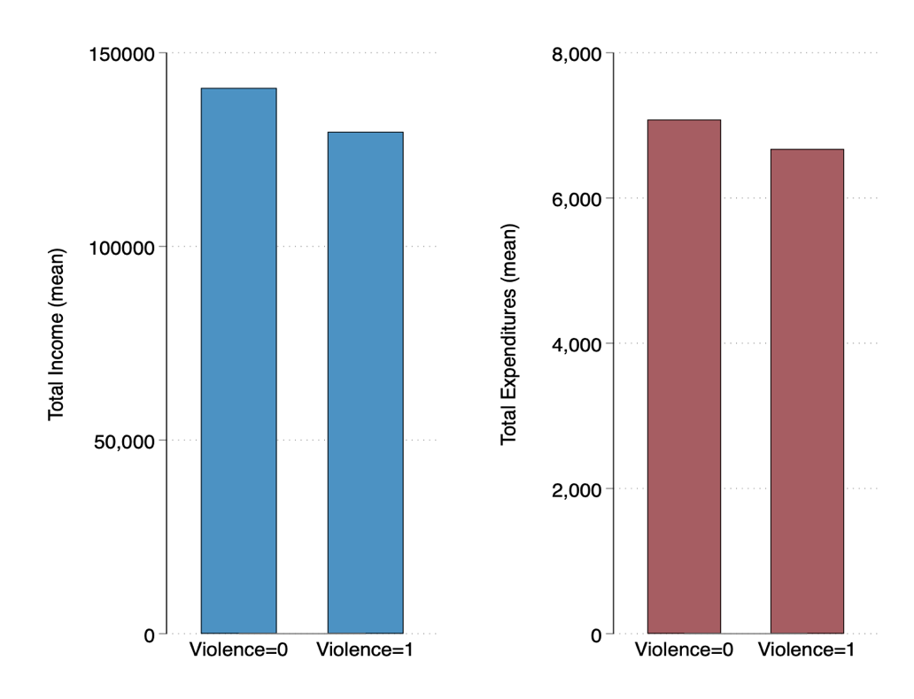
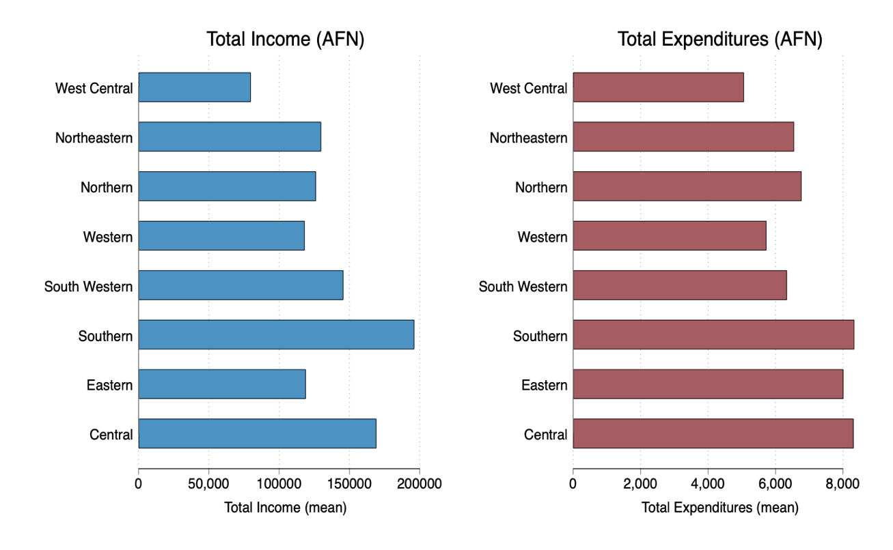
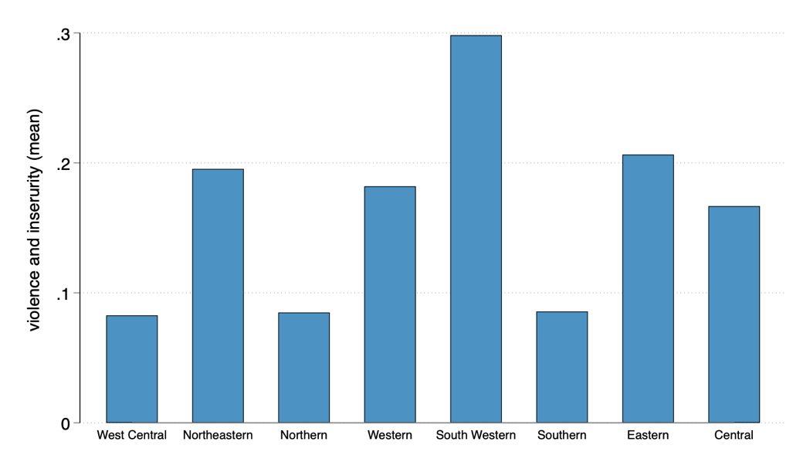
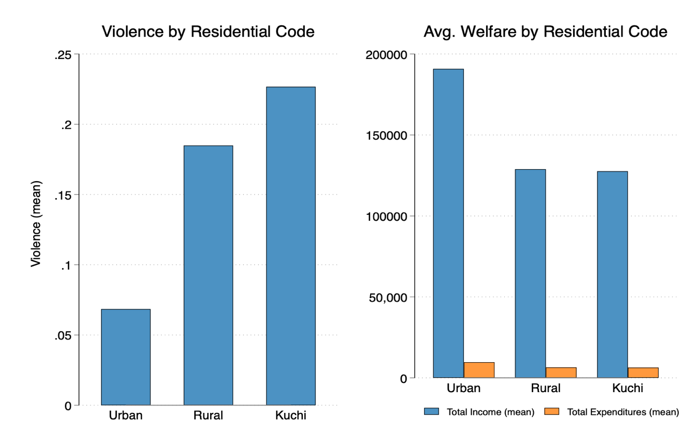

# The Impact of Violence and Insecurity on Household Welfare: Evidence from Afghanistan

Bachelor's thesis in Economics, American University of Central Asia (April 2024). I estimate how exposure to violence and insecurity relates to household income and consumption expenditure in Afghanistan, using about 60,000 household observations from three waves of the national Afghanistan Living Condition Survey (2011/12, 2013/14, 2016/17).

[Read the full thesis](afghanistan_violence_household_welfare_thesis.pdf) · [Stata analysis code](analysis.do)

**Tools:** Stata (`regress`, `winsor2`, `asdoc`)

---

## 1. Question

Does a household's exposure to violence and insecurity go along with lower income and lower spending, after accounting for household characteristics, location and survey year?

## 2. Data

- **Source:** Afghanistan Living Condition Survey (ALCS), conducted by Afghanistan's National Statistics and Information Authority (formerly the Central Statistics Organization). Waves: 2011/12, 2013/14 and 2016/17, pooled.
- **Sample:** 60,479 households after dropping observations with missing values.
- **Outcomes:** log total household income and log total household expenditure (in Afghani). Outliers are trimmed at the 0.25th and 99.75th percentiles within each survey wave.
- **Key variable:** a 0/1 indicator for whether the household experienced a violence or insecurity shock. About 16.7% of households are coded 1.
- **Controls:** education, age, sex and employment of the household head; household size; dependency ratio; district-level opium cultivation; urban/rural/Kuchi residence; region; and survey wave.
- The survey microdata are not included in this repository (the file is over 1 GB, and the survey belongs to the statistics office). Contact the NSIA for access.

## 3. Method

Ordinary least squares with robust standard errors:

`log(welfare) = b0 + b1*violence + controls + region + wave + error`

estimated separately for log income and log expenditure.

## 4. Results

| | Log income | Log expenditure |
|---|---|---|
| Violence (0/1) | -0.073 (SE 0.008) | -0.021 (SE 0.006) |
| Observations | 60,479 | 60,479 |
| R-squared | 0.268 | 0.330 |

Households that experienced violence have about 7% lower income and about 2% lower consumption expenditure, holding the other variables constant. Both estimates are significant at the 1% level.

Average income is lower in households that experienced violence (about 129,600 AFN versus 140,900 AFN), and so is average spending:

Welfare varies a lot by region, and so does violence. Violence is highest in the South Western region and lowest in the West Central, Northern and Southern regions:

Violence is also much lower in urban areas than in rural areas and among the Kuchi (nomadic) population:

District-level opium cultivation is not statistically significant in either model.

## 5. Limitations

- These are associations from pooled survey cross-sections, not causal estimates. Households that are poorer for other reasons may also live in more violent areas.
- Violence is a single 0/1 indicator, so it can't separate the type or severity of violence.
- Survey waves are different households each time, so I can't follow the same household over time.

## 6. Reproducing the results

1. Get the ALCS data file (`alcsucdp111316_cd22.dta`) and put it in a folder with `analysis.do`.
2. Install the packages in Stata: `ssc install asdoc` and `ssc install winsor2`.
3. Edit the `cd` line in `analysis.do` to your folder and run the file.

It produces the summary tables, the regression tables and the charts. Running it reproduces the numbers above.

## 7. Repository contents

| File | Description |
|---|---|
| `afghanistan_violence_household_welfare_thesis.pdf` | The full thesis |
| `analysis.do` | Stata code for the tables, regressions and charts |
| `*.png` | Charts used in this README |

---

**Author:** Habib Gul Ahmadzai
